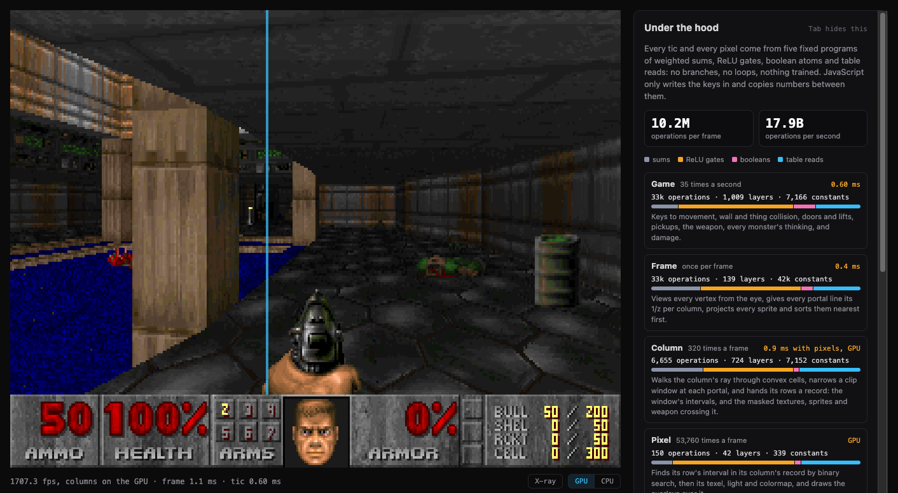
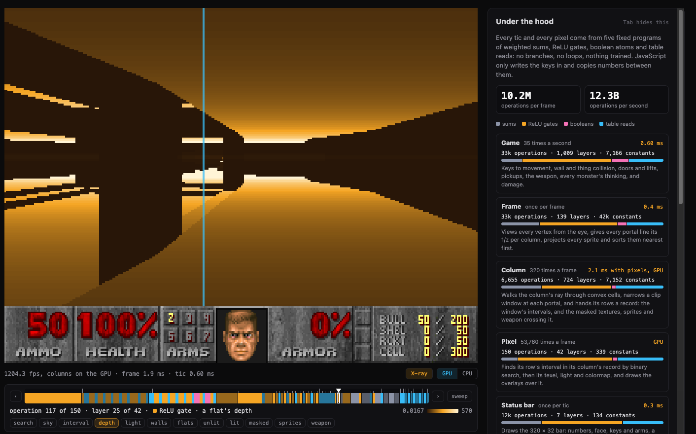
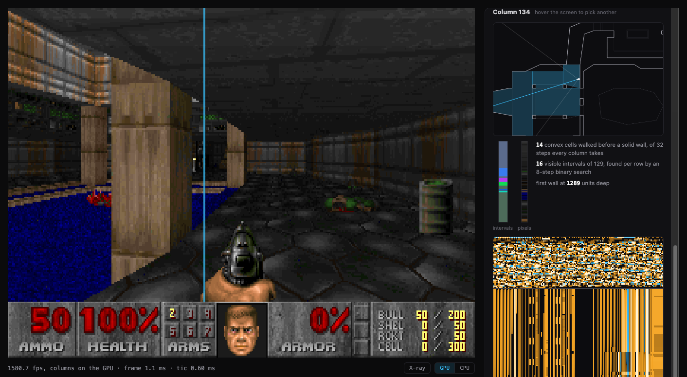

# Doom

Doom's E1M1 as Handwired programs: every tic of the game and every pixel of the screen is computed by fixed lists of weighted sums, ReLU gates, boolean atoms and table reads, with no branches and no loops at runtime. JavaScript writes the held keys into a table, copies numbers from one program's outputs to the next one's inputs, and shows palette indices through the palette that the game program picks. Apart from the x-ray's shading of values, it computes nothing else. [docs/tutorial.md](../../docs/tutorial.md) introduces cells, builder code and programs.

From the repo root:

```sh
bun scripts/fetch-doom-wad.ts            # Doom's shareware DOOM1.WAD 1.9 into .cache/doom/, checked by SHA-256
bun scripts/fetch-doom-wad.ts freedoom   # or Freedoom 0.13.0's freedoom1.wad
bun run start:doom                       # the page at http://127.0.0.1:3001/, PORT for another port; reload after edits
bun test tests/doom                      # 19 tests in 1 file, about 20 s; skipped without the shareware WAD
bun scripts/check-doom-page.ts           # the running page in headless Chrome, see "How to test"
```

The page takes ?wad=freedoom for Freedoom's WAD, ?columns=cpu to start the column and pixel programs on the CPU, ?columns=tensor to run them there on the runtime's evaluator, and ?detail=low or ?detail=high for 160 or 320 columns. The page isn't on the demo site, since it needs a WAD that the repo doesn't carry ([sources and licenses](#sources-and-licenses)).

Keys: W/S or the arrows to move and turn, A/D or comma and period to strafe, Shift to run, Ctrl, F or a click to fire, Space or E to use, 1 2 3 for fist, pistol and shotgun. Shortcuts with Cmd stay the browser's. G, or the switch under the screen, moves the column and pixel programs between the GPU and the CPU while the game runs. X, or the X-ray button, shows one operation of the pixel program at every pixel instead of the picture: Z and C step to the previous and next operation, with Shift a layer, and P sweeps from the shown one to the last ([the x-ray](#the-x-ray)). Tab shows or hides the inspector, which shows the programs' sizes, mixes of instructions and times, how the GPU's shaders are compiling, and, for the column under the pointer, the cells its ray walks, its intervals, and the value of every operation of its column program and of its pixel program for each of its rows.



## The programs

| Program | Runs | E1M1 (shareware), 320 columns | What it does |
| --- | --- | --- | --- |
| game, [game-program.ts](game-program.ts) | 35 times a second | 33k operations, 1,009 layers | Doom's player movement with wall and thing collision, the BSP walk that finds the player's cell, used and crossed lines, doors, lifts and floors, pickups, the weapon, every monster's thinking and hearing, fireballs, barrels, damage and death, light effects, and the palette: red after damage, gold after a pickup |
| frame, [frame-program.ts](frame-program.ts) | once per frame | 33k operations, 139 layers | Every vertex seen from the eye, every portal line's 1/z per column, projected sector heights, every thing's sprite projection, a bitonic sorting network over the things, the weapon's sprites |
| column, [column-program.ts](column-program.ts) | once per screen column, 320 per frame | 6,655 operations, 724 layers | The column's ray through a fixed 32 steps of convex cells and a clip window narrowed at each portal, then a record for its rows: the window's 130 boundaries and what each of its 129 intervals shows, its 2 nearest masked textures, its 3 nearest sprites and the weapon, 960 numbers |
| pixel, the same file | once per pixel, 53,760 per frame | 150 operations, 42 layers | A binary search over its column's boundaries for its row's interval, a texture, flat or sky texel, a light level and a colormap read; then the masked textures, sprites and weapon over it |
| status bar, [status-program.ts](status-program.ts) | at most once per tic, as Doom redraws it only when it changes | 12k operations, 7 layers | The 320 × 32 status bar: numbers, face, keys and arms, a table read per pixel of each of these, and constant pixels for the rest |

Operations are the ones that compute: a program's constants, e.g. the entries of its tables, are counted apart. The frame program's per-column work grows with the view's width, so its size is 32,867 operations at 320 columns and 32,996 at the tests' 64. tests/doom/doom.test.ts pins these sizes.

[engine.ts](engine.ts) builds and runs them, and the page runs the engine in [worker.ts](worker.ts). The game and status programs run on the runtime's own evaluator, since generated code that runs once per tic stays in the JavaScript engine's interpreter. So does the frame program when the CPU draws the columns; when the GPU does, frames come often enough that the worker runs it as generated JavaScript, about twice as fast. The worker only schedules: it renders frames back to back and posts each as it comes, rendering the next while the page shows the last, and runs the tics that are due before each frame.

The column and pixel programs run on WebGPU where the browser has it. [wgsl.ts](wgsl.ts) writes each as a compute shader, one `let` per operation: the column shader runs an invocation per screen column and writes its record into a buffer, and the pixel shader an invocation per pixel, which reads its column's record. [gpu.ts](gpu.ts) runs both in one submission per frame, two passes, and reads the pixels back. Frames overlap: while the GPU draws one, the CPU runs the next one's frame program and writes its source, and the queue keeps each frame's passes and copy in order, each with its own readback buffer. Metal folds (x + c) - c to x, which would delete every boolean atom and every round, so the shaders write those as select() and round().

What it costs, on an Apple M4 Mac mini in Chrome 155, headless, as scripts/check-doom-page.ts reports it: a frame's pixels come back about 1 ms after its source is written, and the page shows about 1,500 to 1,750 frames a second with the inspector open, some 15 to 18 billion operations a second at 10.2 million per frame. Doom's game runs 35 tics a second, so most of those frames show the same tic: the count measures how fast the programs run, and the display shows as many as it refreshes. The inspector redraws once per display refresh, and a hidden page takes frames slowly. The shaders are 560 KB and 13 KB of WGSL, which compile in parallel while the CPU draws: in 2.9 s cold, 0.57 s once Metal has cached them, and 0.32 s on a reload in the same browser profile. The line under the screen and the inspector's WebGPU section show each shader's compile as it goes.

The page draws two GPU frames on the CPU too and reports how many pixels differ: the first, drawn alone, and the first whose pixels come back after a frame of a later tic was written to the GPU, which checks that overlapping frames keep to their own source. In the runs for this README none differed, 0 of 107,520 pixels. In some views a few do, where Metal fused a product into a sum and a record value came out one unit in the last place off the CPU's, enough to move a texel or a boundary at its edge (the comment at the top of [wgsl.ts](wgsl.ts)).

Without WebGPU, i.e. without `navigator.gpu` or without an adapter, with ?columns=cpu, or switched to the CPU, the column and pixel programs run as generated JavaScript ([codegen.ts](codegen.ts)), which gives the runtime evaluator's bits several times faster once the JavaScript engine has optimized it, at Doom's 160 low-detail columns: about 65 frames a second. The switch keeps the columns the page started with: a page that started on the GPU draws all 320 on the CPU, at about 30 frames a second, and one that started on the CPU keeps its 160 on the GPU, which compiles its shaders the first time it is switched on. The frame program moves with the frames: generated JavaScript at the GPU's rates, the runtime's evaluator at the CPU's.

## The x-ray

The x-ray shows what one of the pixel program's 150 operations computes, at every pixel. A strip under the screen has a cell per operation, in execution order, colored by its instruction and grouped into the program's 42 layers, with a tick at each of the 34 operations that [column-program.ts](column-program.ts) names, taller at the 12 that have a button under the strip. Dragging on the strip, the arrows beside it, Z and C, a button or a click on the inspector's activations picks an operation. The sweep steps from the shown operation to the last, the weapon drawn over the pixel, pausing at the 12, and starts from the binary search's first comparison when the last one shows. The line under the strip names the operation, its layer and its instruction.



Operations whose values are palette indices, e.g. the unlit texels and the texels through their colormap, show through Doom's palette. Any other shows in the inspector's colors, amber for positive values, blue for negative ones and dark for zero, from dark to light across the range of the frame's values without its outermost half percent at either end; the line under the strip gives the range. Every pixel computes a wall, a flat and the sky before its interval picks one, so e.g. a flat's depth shows on the walls too, and the sky's texel, which needs only the row, is computed in the program's third layer.

The programs run as they do for the picture, and only another of the pixel program's values comes out. On the CPU the generated code and the evaluator keep every value, so the worker reads the operation's instead of the pixel's. On the GPU the probe shader does it: the pixel shader with every operation kept, a round's shifted sum among them, which writes the bits of the operation that a uniform picks. It is 19 KB of WGSL and compiles the first time the x-ray is on while the GPU draws, while the picture shows, in some 0.2 s cold and 13 ms once Metal has cached it; the inspector's WebGPU section shows it with the other shaders. The x-ray then runs at about 1,100 to 1,700 frames a second on the GPU, and on the CPU as fast as the picture there. The worker turns the values into shades of the x-ray's palette, which, like the palette, is the display's part. Naming a wire leaves the program as it is, and the tests check that the x-ray's last operation is the picture and that its palette stops hold palette indices.

## How the renderer fits a fixed program

Doom draws walls by walking its BSP front to back and stopping where the screen is full: a loop of unknown length. [level.ts](level.ts) instead builds its own BSP from the linedefs when the programs are built, since the WAD's nodes round their split points to whole units and leave slivers, and merges its leaves into 201 convex cells joined by portals. A column's ray then crosses one portal per step: in a convex cell, the edge it leaves through is where its vertices go from right of the ray to left, which a binary search finds in 4 probes. Each portal's floor and ceiling heights narrow a window of rows, as Doom's ceilingclip and floorclip arrays do. The window's boundaries, 4 per step, are sorted down the column, so each row finds its interval with an 8-step binary search, and the interval says what the row shows. The walk is the column program's, and the search and everything after it the pixel program's: the column hands its rows its boundaries and intervals as input cells of the pixel program, declared with the ranges and grids the column program proves for them, so the pixel program builds the operations the walk's own wires would.



Walls, flats and sky are computed for every row and the row's interval picks one, since a program can't skip work. Depth for texture mapping comes from Doom's own trick, tables of secants and tangents indexed by fine angle, and 1/z for projection from each line's plane equation, linear in the column, so no step divides. [tests/doom/reference.ts](../../tests/doom/reference.ts) is the walls, flats and sky in plain JavaScript, in float64, without the masked textures, sprites and weapon, and the tests compare the two with those left out: every window boundary within a row, and more than 98% of pixels exactly, the rest at texel boundaries where FP32 rounds differently.

The tests also run every program on the runtime's reference evaluator over a walk that fires, opens doors and keeps things in view, and check that every value lies on the grid its program declares or infers and that none is NaN, records and sprites included. They don't run `validateIndexReads`: the programs read tables at fractional indices and rely on the read's floor, which [docs/execution-model.md](../../docs/execution-model.md#index-reads) describes and which the evaluator, the generated JavaScript and the shaders all do, where that contract asks for an integer index. Over the tests' walk, 2 of the game program's reads take a fractional index (each imp's aim for its fireball), 513 of the frame program's (most of them the seeds of reciprocals), 32 of the column program's and 9 of the pixel program's (light levels and texels at a fractional row). Flooring each first would cost 3 operations a read.

## What differs from Doom

- Monsters try one direction per A_Chase and the next candidate at their next one, instead of up to nine in one call, and don't open doors or trigger lines.
- Pain doesn't make a monster's next missile check pass, Doom's MF_JUSTHIT, or reset its reaction time.
- An imp has one fireball: a new launch takes back the one in flight. Fireballs fly through monsters.
- Hitscans and line of sight ignore heights, and explosions hurt through walls.
- Sound floods through two-sided lines as Doom's P_RecursiveSound does, through at most one sound-blocking line, but takes doors as open, and there is no audio.
- Use triggers every special line that the 64-unit use line crosses, even behind a wall, where Doom stops at the first line.
- Turning has no slow start, and thrust and friction apply in the air too.
- Armor absorbs a third of damage, the blue armor too, where Doom's absorbs half. A weapon pickup doesn't switch to the weapon, and the shotgun is taken even with shells full. Freedoom's E1M1 has a berserk pack, taken only below 100 health and with no berserk, and a chainsaw, which does nothing.
- A column draws at most its 3 nearest sprites and its 2 nearest masked textures. A frame hands the columns its 32 nearest things on screen, behind walls or not, so a view with more things in front of it can leave out one that shows: about 1 view in 100 of shareware E1M1 leaves out one to three, and some views of Freedoom's many more.
- A ray takes at most 32 portal steps, and past them the column shows black. No view of shareware E1M1 needs more. Of Freedoom's E1M1, about 1 view in 100 does with its doors closed and 3 in 100 with them open, with up to 2% of a view's pixels black.
- Random numbers come from a table of its own, so Doom's demos don't play back.
- Positions are FP32 rather than 16.16 fixed point. E.g. an FP32 sum of a sprite's texel address, up to 2^20, and a fractional row keeps a sixteenth of a texel, so a sprite's row can come out a 32nd of a texel early. Sprite and masked texture columns each end in a transparent texel, so a row past the end shows nothing.

## Sources and licenses

[states.ts](states.ts) is info.c's `states[]` from id Software's linuxdoom-1.10 source, released under the GPL-2.0 in 1999: the rows for the sprites E1M1 uses, in their order, each a sprite, a frame, its tics, its action and its next state. [things.ts](things.ts) holds the same file's `mobjinfo[]` values for the things E1M1 uses: sizes, health, speeds, pain chances and states. [actors.ts](actors.ts), [game-program.ts](game-program.ts) and [physics.ts](physics.ts) build what p_enemy.c, p_user.c, p_map.c, p_spec.c and p_lights.c do, and name the functions they follow, without their code.

The WADs aren't in the repo. scripts/fetch-doom-wad.ts downloads id Software's shareware DOOM1.WAD 1.9 from Debian's doom-wad-shareware package, which Debian keeps in non-free, since id's shareware terms let it be copied and passed on unmodified and free of charge but not modified, or Freedoom 0.13.0's freedoom1.wad, under a BSD-style license, from Freedoom's GitHub releases. It checks the archive's and the WAD's SHA-256 and writes the WAD into .cache/doom/, which .gitignore leaves out. The page fetches it from scripts/serve-doom.ts. This README's screenshots show the shareware WAD's graphics, which are id Software's.

## Files

| File | What it holds |
| --- | --- |
| [`assets/doom.html`](../../assets/doom.html), [`assets/doom.css`](../../assets/doom.css) | The page and its styles |
| `assets/doom-e1m1.webp`, `doom-xray.webp`, `doom-inspector.webp` | This README's screenshots: the page in headless Chrome 155 on an Apple M4, after a few seconds' walk from the start |
| `main.ts` | The page: fetches the WAD, starts the worker, sends it the held keys, shows its frames through the palette, the switch and the x-ray's controls |
| `worker.ts` | The engine in a worker: builds the programs, runs the tics that are due, renders frames ahead of the page on the GPU or the CPU, compiles the shaders and the probe shader, checks two GPU frames against the CPU, shades the x-ray |
| `inspector.ts` | The inspector beside the screen, drawing only |
| `engine.ts` | Builds the five programs for a level, runs them on a backend each, and copies each one's outputs into the next one's cells |
| `game-program.ts` | The game program: the player, lines and movers, things' states, pickups, damage, lights and the palette |
| `actors.ts` | Builder code for what acts: the weapon and its shots, monsters, fireballs and barrels, and the random table |
| `physics.ts` | Builder code for the BSP walk that finds a point's cell, and Doom's P_CheckPosition |
| `raycast.ts` | Builder code for rays through the cells from anywhere: line of sight and hitscans |
| `frame-program.ts` | The frame program |
| `column-program.ts` | The column and pixel programs, and the x-ray's named operations |
| `sprites.ts` | Builder code for sprites: their projection and sorting in the frame program, their columns in the column program and their texels in the pixel program, and the weapon's |
| `status-program.ts` | The status bar program |
| `ops.ts` | Builder functions the programs share: rounding, a floor, sign bits, min, max and clamps |
| `codegen.ts` | A compiled program as JavaScript statements, the CPU backend for the column, pixel and frame programs |
| `wgsl.ts`, `gpu.ts` | The column, pixel and probe shaders, and the WebGPU host that runs them |
| `wad.ts`, `assets.ts` | The WAD reader, and a level's graphics as tables of palette indices |
| `level.ts`, `scene.ts`, `view.ts` | The level as convex cells, portals and a BSP; the tables every column reads; the view's geometry and angle tables |
| `things.ts`, `states.ts` | The level's things, their types and states as tables, and the sprites' texels |
| [`tests/doom/`](../../tests/doom) | The tests, the reference renderer, and an interpreter of the shaders' WGSL |
| [`scripts/serve-doom.ts`](../../scripts/serve-doom.ts), [`scripts/fetch-doom-wad.ts`](../../scripts/fetch-doom-wad.ts), [`scripts/check-doom-page.ts`](../../scripts/check-doom-page.ts) | The page's server, the WAD's download, and the page's check in headless Chrome |

## How to test

`bun test tests/doom` runs without a GPU and without a browser, and needs the shareware WAD; without it the tests are skipped. `bun run test` runs them with the rest of the repo. The tests, by what they check:

- **level**: the cells are convex and counterclockwise, every portal has exactly one twin, and the BSP finds the cell of each cell's center.
- **the column program**: the frame, column and pixel programs with the overlays left out, on the runtime's evaluator with its checks of every cell, against the reference renderer in 4 views.
- **sprites**: a barrel that the screen's left edge cuts starts at the texture column that Doom's R_DrawVisSprite would.
- **the JavaScript backend**: the generated JavaScript gives the evaluator's bits on a real frame's columns and pixels, plays the same game over three phases of keys while the frame program changes backend, and the x-ray's last operation is the picture, its palette stops hold palette indices, and probing leaves the picture as it was.
- **the shaders**: run on the CPU by tests/doom/shader-interpreter.ts, the column, pixel and probe shaders give the evaluator's bits for a frame: every pixel, and the probe's values at the 12 stops with buttons. Each declares every value before reading it, writes rounds and boolean atoms as select() and round(), and the probe shader keeps every operation, with a case per operation. The interpreter reads only the WGSL that wgsl.ts writes, rounds every f32 operation on its own, as WGSL does when no compiler fuses them, and fails on a read outside a buffer. Bun has no WebGPU, and scripts/check-doom-page.ts runs the shaders on a GPU.
- **the declarations**: every value of every program on its grid and none NaN, over a walk.
- **the game**: the sizes above; walking at Doom's speed and a wall that stops it; a door that opens and closes after its wait; a pickup that raises its counter once and disappears; the pistol killing a zombieman in sight; Doom's red palette by the damage count and the gold one after a pickup; a shot that wakes none of shareware E1M1's monsters, which are all in ambush; after death, the weapon staying down, the view sinking a unit per tic and a chasing monster giving up; and Space after death starting the level over.

`bun scripts/check-doom-page.ts [url] [screenshot folder]` drives a running page in headless Chrome and prints what it shows: the GPU's compile steps, a few seconds of play, the inspector, the switch both ways, every x-ray control, the probe shader's compile and the x-ray on both sides of the switch, the GPU's check against the CPU, and the page's console errors, with screenshots. CHROME_PATH names Chrome's binary if it isn't at the macOS default, and with RELOAD set, the page loads a second time in the same profile.
